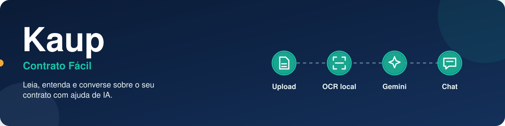
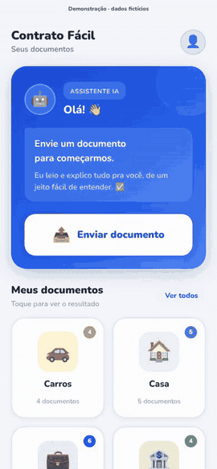
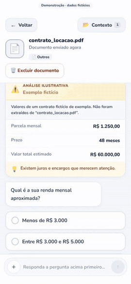
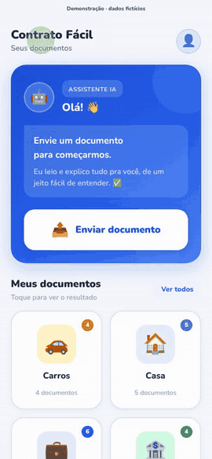
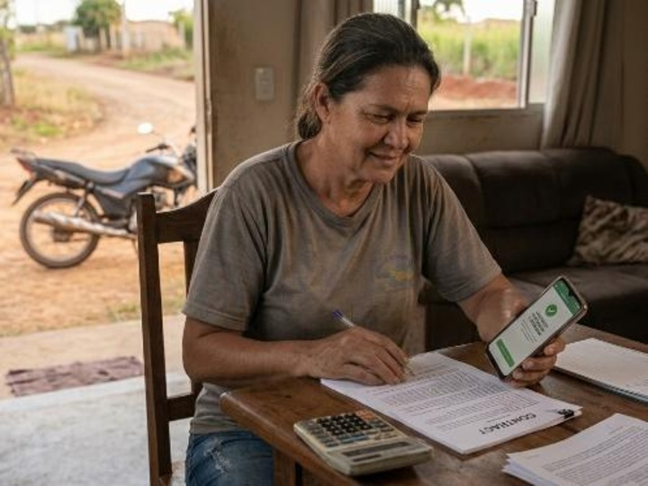
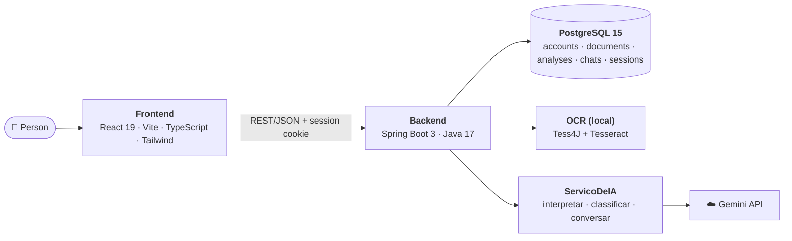
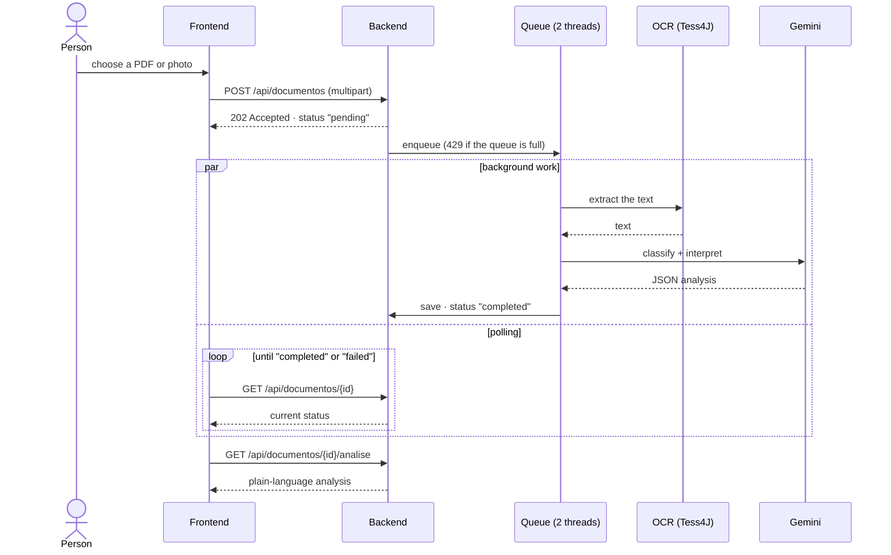
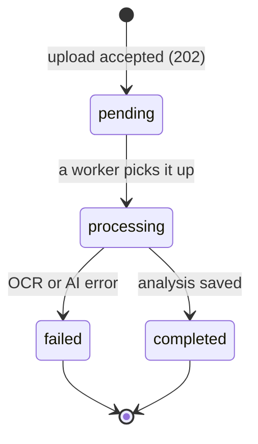

<div align="center">



<br>

[](https://github.com/mackcoder/Kaup/actions/workflows/ci.yml)


**An AI that reads contracts and explains them in plain language.**
Upload a PDF or a photo, get a plain-language summary, and chat about it.

[See it in action](#-see-it-in-action) · [Try it in 1 minute](#-try-it-in-1-minute-demo-mode) · [How it works](#-how-it-works) · [Run the full stack](#-run-the-full-stack) · [API](#-api) · [Team](#-team)

</div>

> **Course:** Software Engineering Laboratory · **Professor:** Gustavo Moreira Calixto · **Methodology:** Scrum / Agile
>
> Kaup is a university project, built to be tested by classmates and professors. The app's interface is called **Contrato Fácil** and is in Brazilian Portuguese.

---

## 🎬 See it in action

<table align="center">
  <tr>
    <td align="center"><b>1 · Send a contract</b></td>
    <td align="center"><b>2 · Ask the chat</b></td>
    <td align="center"><b>3 · Categories and profile</b></td>
  </tr>
  <tr>
    <td></td>
    <td></td>
    <td></td>
  </tr>
  <tr>
    <td align="center">Pick a PDF or photo, confirm, and read the summary.</td>
    <td align="center">The assistant asks for your income range and answers free-text questions.</td>
    <td align="center">Contracts by category; choose how detailed the explanations are.</td>
  </tr>
</table>

> These GIFs were recorded with the frontend in **demo mode** (`VITE_DATA_SOURCE=mock`): the analysis you see is an illustrative, fictional contract and the chat replies are scripted. With the backend running, the file goes through real OCR and the answers come from Gemini.

---

## ⚡ Try it in 1 minute (demo mode)

No Docker, no database, no API key. Only [Node.js 22.12+](https://nodejs.org/):

```bash
git clone https://github.com/mackcoder/Kaup.git
cd Kaup/frontend
cp .env.example .env      # VITE_DATA_SOURCE=mock is the default
npm install
npm run dev               # open http://localhost:5174
```

You get the whole interface with fictional data. To use the real pipeline, see [Run the full stack](#-run-the-full-stack).

---

## 🎯 Why Kaup exists

In Brazil, many people struggle to understand contracts because of complex legal and financial language, especially those with low functional literacy. They may sign agreements without fully understanding costs, deadlines, interest rates and penalties. Kaup was born from the idea of helping these people read what they are about to sign, so they are less exposed to scams and bad deals.

We designed it around three personas (see [`docs/Personas`](docs/Personas)):

<table>
  <tr>
    <td align="center" width="33%"><br><b>Marta da Silva, 49</b><br>Informal worker who wants to finance a motorbike and fears hidden fees.</td>
    <td align="center" width="33%"><br><b>Gabriel Ouvirstappen, 16</b><br>Racing enthusiast; he and his father have already lost money on misleading contracts.</td>
    <td align="center" width="33%"><br><b>Pedrinho Akira, 23</b><br>Recently engaged and signing several contracts at once.</td>
  </tr>
</table>

---

## ✨ What it does

| | Feature | Details |
|---|---|---|
| 📄 | **Read** | Upload a PDF, PNG or JPEG (up to 10 MB). Text is extracted by **local OCR** (Tess4J + Tesseract, Portuguese); digital PDFs with enough text skip OCR. |
| 💡 | **Explain** | Gemini turns the contract into plain language: amounts, deadlines, penalties and attention points. The analysis uses **only what is in the contract**, with no opinions. |
| 💬 | **Chat** | Ask anything about the contract. Opinions only appear here, and only when you ask. If you share your income range, the assistant can say whether the commitment fits your budget. |
| 🗂️ | **Organize** | The AI classifies each contract as Carros, Casa, Trabalho, Banco or Outros. You can change the category. |
| 🧑 | **Personalize** | Choose how detailed the explanations should be and save your income range in your profile. |
| 🔐 | **Your data is yours** | Per-person accounts, data export (JSON), account deletion and automatic retention limit. |

---

## 🧠 How it works



An analysis is **asynchronous**: OCR and AI take time, so the API accepts the upload immediately and the frontend follows the status.





### Why we built it this way

| Decision | Why |
|---|---|
| **Local OCR** (Tess4J) | Text is extracted on the project's own server, with no per-page cost. |
| **AI behind an interface** (`ServicoDeIA`) | The provider can be swapped, and tests can use a fake. |
| **Async analysis** (202 + queue) | OCR and AI are slow; the app never freezes and the server protects itself (`429` when the queue is full). |
| **Hardened prompt** | The contract is treated as data, never as instructions (prompt-injection resistance). |
| **Session cookie** (`httpOnly`) | The session token stays out of reach of page scripts. |
| **Demo mode in the frontend** | Front and back evolved in parallel; the whole UI runs with fictional data. |
| **Docker Compose** | Anyone starts the database and backend with one command. |

---

## 🛠️ Tech stack

| Layer | Technology |
|---|---|
| Frontend | React 19, React Router 7, Vite 7, TypeScript, Tailwind CSS v4, Vitest |
| Backend | Spring Boot 3, Java 17, Maven, Spring Security, Spring Data JPA, Spring Session JDBC |
| Database | PostgreSQL 15 |
| OCR | Tess4J (Tesseract) + Apache PDFBox for PDFs |
| AI | Google Gemini (default model `gemini-3.5-flash-lite`) |
| Infra | Docker Compose, GitHub Actions |

---

## 🚀 Run the full stack

Requirements: Docker with Compose, Node 22.12+ and a free [Gemini API key](https://aistudio.google.com/apikey). The full guide (install from scratch, Linux, WSL, macOS, Windows, Codespaces, troubleshooting) is in **[RODAR.md](RODAR.md)** (Portuguese). Short version, from the repository root:

```bash
cp .env.example .env                                   # fill in GEMINI_API_KEY and POSTGRES_PASSWORD (.env is git-ignored)
(cd frontend && cp .env.example .env && npm install)   # then set VITE_DATA_SOURCE=api in frontend/.env
scripts/rodar.sh                                       # backend + PostgreSQL (Docker) + frontend; opens http://localhost:5174
scripts/parar.sh                                       # stops everything (data is kept)
```

> ⚠️ Never run `docker compose down -v`: the `-v` deletes the database. Start the backend before the frontend, otherwise the app shows "Não foi possível falar com o servidor".

| Service | Address |
|---|---|
| App (frontend) | http://localhost:5174 |
| API (backend) | http://localhost:8080 (health check: `curl http://localhost:8080/api/analise/health`) |

**Accounts.** Create an account on the "Criar conta" screen (name, e-mail, password with 8+ characters). Each person only sees their own documents. A development administrator (`ADMIN@ADMIN` / `ADMIN`) is created on startup; it can **read** every document but cannot change other people's documents. **Set `KAUP_ADMIN_PASSWORD` (or `KAUP_ADMIN_ENABLED=false`) before publishing the system.**

**Password recovery is simulated** by project decision: no e-mail is sent and the code is always `676869` (`KAUP_CODIGO_FAKE`; set it empty to turn recovery off). The administrator's password can never be changed through the app.

### Configuration (`.env`)

| Variable | Purpose | Default |
|---|---|---|
| `POSTGRES_PASSWORD` | Database password (required) | none |
| `GEMINI_API_KEY` | Gemini key (required to analyze and chat) | none |
| `GEMINI_MODEL` | Gemini model | `gemini-3.5-flash-lite` |
| `KAUP_ADMIN_ENABLED` / `KAUP_ADMIN_EMAIL` / `KAUP_ADMIN_PASSWORD` | Development administrator | enabled, `ADMIN@ADMIN` / `ADMIN` |
| `KAUP_CODIGO_FAKE` | Fixed code of the simulated password recovery | `676869` |
| `KAUP_RETENCAO_DIAS` | Days until documents and chats are deleted (`0` = never) | `180` |
| `KAUP_TETO_DIARIO_GEMINI` | Global daily cap of Gemini calls (`0` = off) | `500` |
| `KAUP_LIMITE_IP_POR_MINUTO` / `KAUP_LIMITE_AUTH_POR_MINUTO` / `KAUP_LIMITE_CADASTROS_POR_HORA` | Per-IP rate limits | `60` / `10` / `5` |
| `KAUP_ANALISE_THREADS` / `KAUP_ANALISE_FILA` | Analysis workers and queue size | `2` / `20` |

---

## 🔌 API

All routes live under `/api` and (except the health check and sign-up, login and password recovery) require a logged-in session.

| Area | Routes |
|---|---|
| Auth | `POST /auth/cadastro` · `POST /auth/entrar` · `POST /auth/sair` · `GET /auth/eu` · `POST /auth/recuperar/solicitar` · `POST /auth/recuperar/redefinir` |
| Documents | `POST /documentos` (multipart; optional `Idempotency-Key`) · `GET /documentos` · `GET /documentos/{id}` · `GET /documentos/{id}/analise` · `DELETE /documentos/{id}` |
| Chat | `GET` / `POST /documentos/{id}/chat/mensagens` |
| Extra context | `GET` / `POST /documentos/{id}/contexto` (multipart) |
| Profile | `GET` / `PATCH /perfil` |
| Account | `GET /conta/exportar` · `DELETE /conta` |
| Health | `GET /analise/health` |

---

## 🔒 Security and privacy

Contracts are sensitive, so privacy (LGPD) was a design concern from the start. Security is proportional to a university project: protect the database, avoid abuse and protect the Gemini quota.

- **Session:** `httpOnly` cookie, `SameSite=Lax`, 7 days, with CSRF protection.
- **Login protection:** 5 wrong passwords block that e-mail for 10 seconds (HTTP 429).
- **Rate limits per IP:** 60 requests/min, 10 auth requests/min, 5 sign-ups/hour.
- **Daily cap** of 500 Gemini calls for the whole system, counted in the database.
- **Retention:** documents and chats are deleted after 180 days (daily job at 03:30).
- **Your data:** download everything as JSON ("Baixar minhas informações") or delete your account.
- **Closed network:** the database has no published port, and the backend listens only on `127.0.0.1:8080`, with memory and CPU limits.
- **Uploads:** only PDF, PNG and JPEG, up to 10 MB; PDFs up to 20 pages.
- **Secrets:** `.env` is git-ignored, and SQL is not logged.

---

## ✅ Quality

- **Tests:** 200+ backend tests (JUnit) and 120+ frontend tests (Vitest).
- **CI** (GitHub Actions, on push and pull request to `main`) runs three jobs:
  1. **Backend:** `mvn verify`.
  2. **Frontend:** install, lint, tests and build.
  3. **Smoke test:** starts PostgreSQL + backend with Docker Compose and exercises the API end to end (tables created, `401` without login, admin login, sign-up validation, profile, empty list, `404`, OCR on a generated image, data export, login lock, simulated recovery and account deletion).

```bash
cd frontend && npm test                                                                    # frontend
docker run --rm -v "$PWD/backend":/app -w /app maven:3.9-eclipse-temurin-17 mvn -B test   # backend, no Java needed
```

---

## 🧭 Methodology and documentation

We used **Scrum**: weekly sprints with daily meetings, a product backlog, one branch per work front and mandatory Pull Requests into `main`, with CI checking each change.

- **Product Owner:** defines and prioritizes requirements and validates deliveries.
- **Scrum Master:** oversees sprints, removes impediments and helps improve the process.
- **Development Team:** implements, tests and integrates the features.

Before coding we did a user-centered design phase:

| Document | Content |
|---|---|
| [`docs/Concepção/Visao_e_CasoDeNegocio.md`](docs/Concep%C3%A7%C3%A3o/Visao_e_CasoDeNegocio.md) | Vision, business case and risks |
| [`docs/Concepção/Requirements.md`](docs/Concep%C3%A7%C3%A3o/Requirements.md) | 29 requirements (functional, non-functional, usability, reliability, performance and support) |
| [`docs/Personas`](docs/Personas) and [`docs/Jornadas`](docs/Jornadas) | Personas and user journeys |
| [`docs/Modelo_Conceitual`](docs/Modelo_Conceitual) | Propositions, systematic questioning and activity analysis |
| [`docs/Concepção/WireFrame.md`](docs/Concep%C3%A7%C3%A3o/WireFrame.md) | Wireframes (16 screens designed in Figma) |
| [`docs/Arquitetura_Software/Projeto_Arquitetural.md`](docs/Arquitetura_Software/Projeto_Arquitetural.md) | Layered architecture |

<table>
  <tr>
    <td align="center"><br>Home</td>
    <td align="center"><br>Chat with context</td>
    <td align="center"><br>Income setting</td>
  </tr>
</table>

---

## 🗺️ Roadmap

- 🎙️ **Voice:** dictate the question and listen to the answer (Web Speech API).
- ☁️ Public deployment with HTTPS.
- 📷 Capture directly from the camera, with a sharpness check.

> **Limitations.** The analysis is illustrative and **does not replace legal or financial advice**. OCR depends on the quality of the image, and the AI can make mistakes, which is why the analysis is restricted to the text of the contract.

---

## 👥 Team

| Name | RA | GitHub |
|---|---|---|
| **André Doerner Duarte** | 10427938 | [DedeDuarte](https://github.com/DedeDuarte) |
| **Matheus Leonardo Cardoso Kroeff** | 10426434 | [Matheus-Kroeff](https://github.com/Matheus-Kroeff) |
| **Naoto Ushizaki** | 10437445 | [mackcoder](https://github.com/mackcoder) |

## ✉️ Contact

Feel free to reach out to the team members with questions, suggestions, or collaborations:

* **André Doerner Duarte**
  * 📧 Email: andredoernerd@gmail.com
  * 💼 [LinkedIn](https://www.linkedin.com/in/andredoernerduarte/)
  * 🐙 [GitHub](https://github.com/DedeDuarte)

* **Matheus Leonardo Cardoso Kroeff**
  * 📧 Email: 10426434@mackenzista.com.br
  * 💼 [LinkedIn](https://www.linkedin.com/in/matheus-leonardo-cardoso-kroeff-23838535b/)
  * 🐙 [GitHub](https://github.com/Matheus-Kroeff)

* **Naoto Ushizaki**
  * 📧 Email: 10437445@mackenzista.com.br
  * 💼 [LinkedIn](https://www.linkedin.com/in/naoto-ushizaki-30b94a172/)
  * 🐙 [GitHub](https://github.com/mackcoder)

## 📚 References

* INSTITUTO PAULO MONTENEGRO. **INAF Brasil 2024: alfabetismo do analógico ao digital.** São Paulo, 2024. Available at: https://alfabetismofuncional.org.br/2024_Relatorio_Inaf_DIGITAL.pdf. Accessed on: Aug. 19, 2026.

* SOUZA, Rakel Brandão de et al. **Produção de conhecimento sobre o analfabetismo funcional e as desigualdades sociais no Brasil.** Goiânia, 2025. Available at: https://revistas.ufg.br/revistaufg/article/view/75874. Accessed on: Aug. 19, 2026.

* CORRÊA, Barbara Priscila de Souza; COLETTA, Carolina. **O acesso ao crédito em bancos digitais e fintechs aumenta a probabilidade de endividamento pessoal no Brasil?** 2024. Available at: https://ojs.unifor.br/rca/article/view/14924. Accessed on: Aug. 19, 2026.
